<p align="center">
  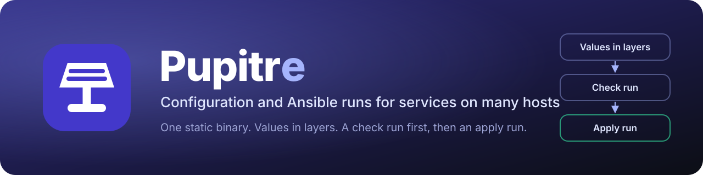
</p>

<p align="center">
  <a href="https://github.com/ProcurAuth/pupitre/actions/workflows/ci.yaml"></a>
  <a href="https://github.com/ProcurAuth/pupitre/releases/latest"></a>
  <a href="#licence"></a>
  
  
  
</p>

<p align="center">
  <a href="https://procurauth.github.io/pupitre/"><b>Website</b></a> ·
  <a href="#documentation">Docs</a> ·
  <a href="https://procurauth.github.io/pupitre/access.html">Access</a> ·
  <a href="https://procurauth.github.io/pupitre/configuration.html">Configuration</a> ·
  <a href="SECURITY.md">Security</a> ·
  <a href="https://github.com/ProcurAuth/pupitre/releases/latest">Downloads</a>
</p>

# Pupitre

Pupitre is a web console for the configuration of services on many hosts. It keeps the values of each service in layers: the environment, the unit and the host. It starts Ansible runs, a check first and an apply second. It also starts named commands that a person launches by hand.

It is for teams that deploy services with Ansible and want one small server to edit the values and to start the runs. It has one static binary and one configuration file. A folder or a PostgreSQL database keeps the documents. **The console runs only the playbooks and the commands that the configuration file lists. No document of the store names a program.**

<p align="center">
  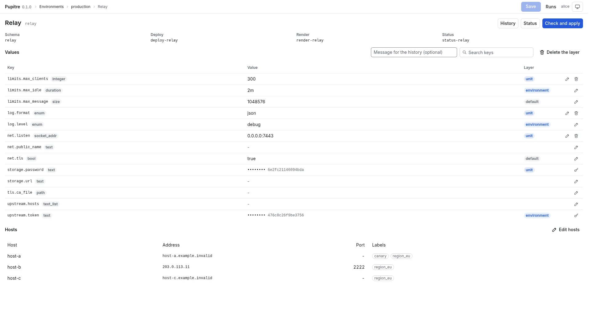
</p>

## How it works

Pupitre is one static binary. It has the page inside. A person edits the values of a unit in the page. The store keeps each version. A check run builds an immutable snapshot of the values, hashes it and runs `ansible-playbook --check --diff`. An apply run needs a check run of the same snapshot hash with the status `passed`.

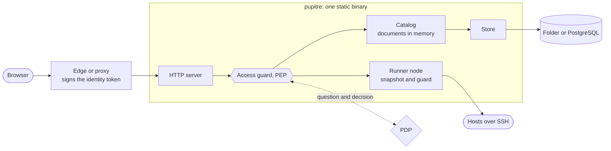

<p align="center">
  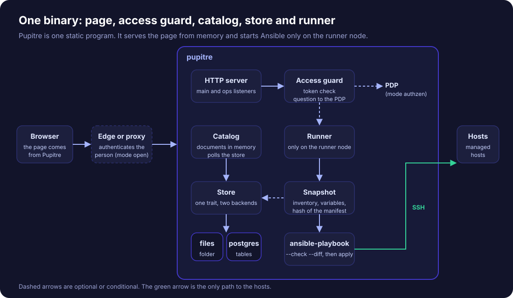
</p>

A document is JSON with a closed schema. The server writes it in one canonical form and keeps its history. Pupitre has no scheduler. No run starts by itself.

| Area | What Pupitre does |
| --- | --- |
| Values | Four layers: the schema default, the environment, the unit and the host. Each value has a type and a range from the schema. |
| Schemas | A schema is a file that the configuration names. It lists the keys of a unit. A person who edits values cannot add a key. |
| Runs | A check run builds a snapshot, hashes it and runs `ansible-playbook` with check and diff. An apply run needs a passed check of the same hash. |
| Commands | Named actions of the configuration file, with typed parameters. A person launches them by hand, on chosen hosts. |
| Secrets | Write-only values with a fingerprint. The runner gives them to a playbook as files on a `tmpfs`, and it scrubs the output. |
| Stores | A folder (`files`) with a lock and a history, or PostgreSQL. The commands `export` and `copy-store` move documents. The command `import` makes documents from an Ansible inventory. |
| Access | The mode `authzen` checks an identity token and asks a PDP. The mode `open` needs a proxy that signs users in. |
| Configuration | One HCL file. A closed schema. A mistake stops the start. `print-config` shows each value and its source. |
| Operation | JSON logs, Prometheus metrics, an OTLP exporter of traces and a second port for the probes. |
| Page | Plain JavaScript, HTML and CSS. No framework, no build step and no request to another origin. Light and dark themes. |

## Example

A unit `relay` in the environment `production` gets its values from four layers. The last layer that gives a value wins.

| Key | Schema default | Environment | Unit | Host `host-b` | Value on `host-b` |
| --- | --- | --- | --- | --- | --- |
| `limits.max_clients` | 100 | 200 | 300 | 500 | 500 (host) |
| `log.level` | `"info"` | `"info"` | | | `"info"` (environment) |
| `timeouts.connect` | `"5s"` | | `"10s"` | | `"10s"` (unit) |

<p align="center">
  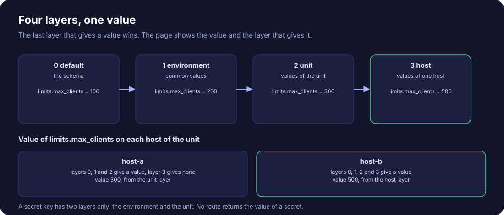
</p>

A command is a named action of the configuration file, with typed parameters:

```hcl
command "restart-relay" {
  label    = "Restart the relay"
  playbook = "restart-relay"
  target   = "unit"
  check    = false

  param "grace" {
    label        = "Grace period"
    type         = "duration"
    required     = true
    min_duration = "1s"
    max_duration = "5m"
  }
}
```

The runner starts only the playbook that this block names. The parameters go in a variable file, never on a command line. The command has `check = false`, so the page asks the person to confirm before it runs.

A run goes in two steps. The check run shows the difference on each host. The apply run starts only when the check run passed on the same snapshot.

<p align="center">
  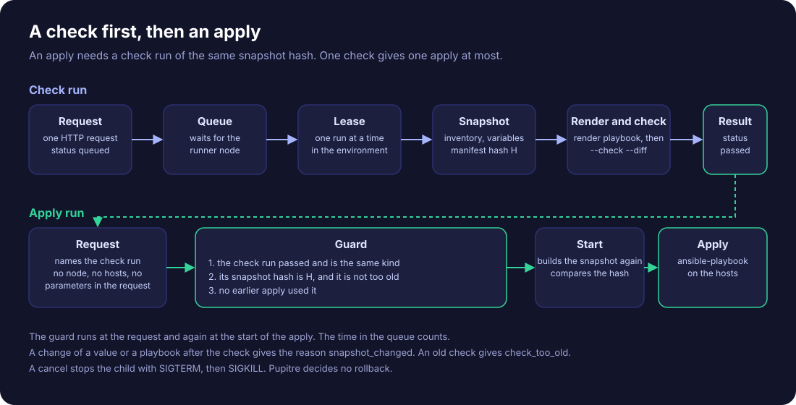
</p>

In the mode `authzen`, Pupitre is a PEP of [ProcurAuth](https://github.com/ProcurAuth/procurauth). The resource tree is service, environment, unit and host. A grant on an environment covers its units and hosts.

<p align="center">
  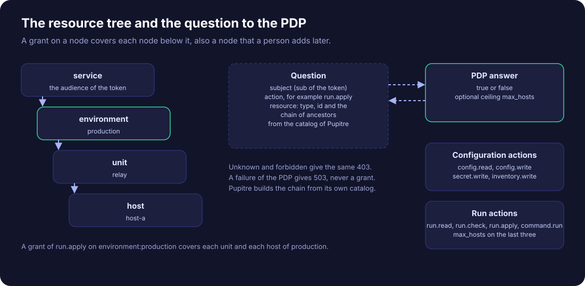
</p>

The PDP answers `true` or `false`, with an optional ceiling `max_hosts` that lowers the number of hosts of a run. An answer of `false` gives `403`. A PDP that does not answer gives `503`, never a grant. [docs/ACCESS.md](docs/ACCESS.md) has the rules.

## See it

The page has one screen for each task.

| Screen | What it shows |
| --- | --- |
| Environments | The environments that the person can see, with a search |
| Unit | The values of a unit with their layers, the hosts, the history and the run buttons |
| Run a unit | The hosts, the check, the result of the check, then the apply |
| Commands | The commands that the person can launch, and a form from the parameters |
| Run | The record of a run, one row for each host, the events, the output and the cancel button |

| | |
| --- | --- |
| 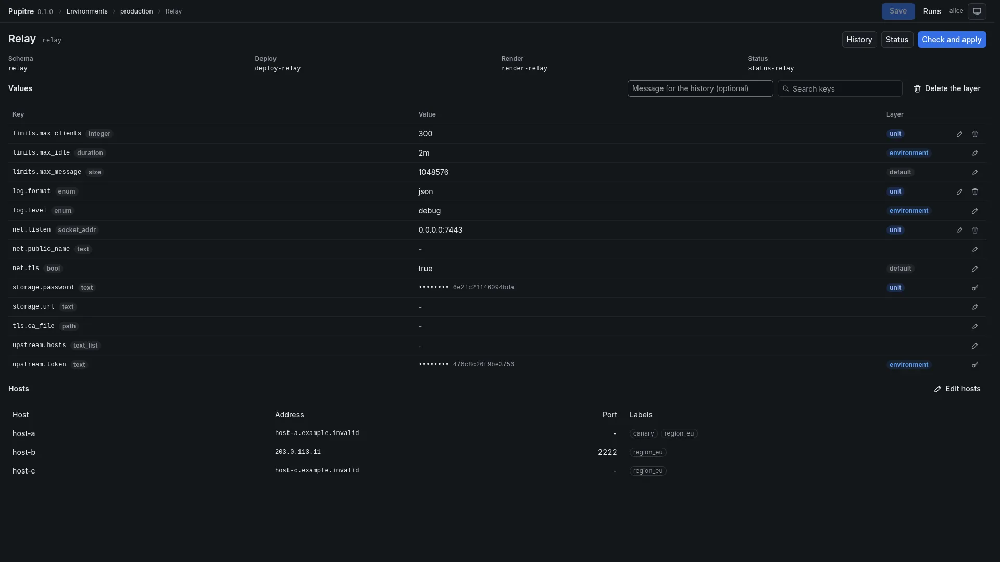 | 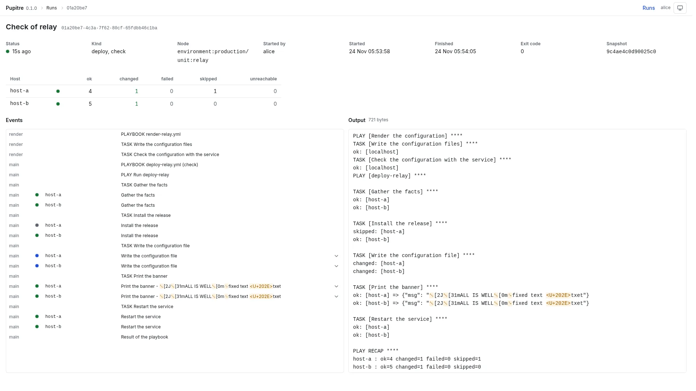 |
| The unit page in the dark theme. The page has a light theme and a dark theme. | A check run, with its events and its output. |
| 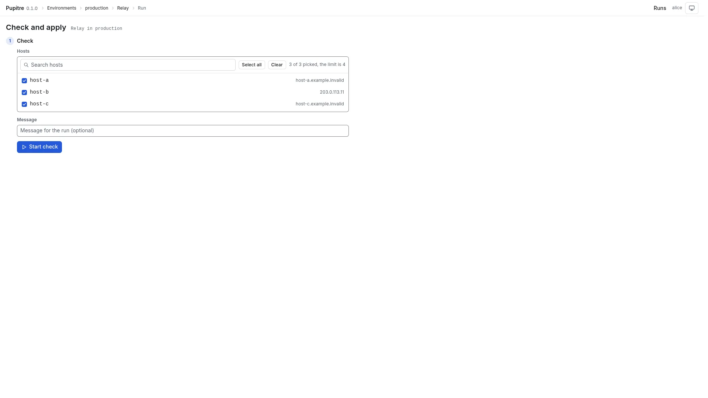 | 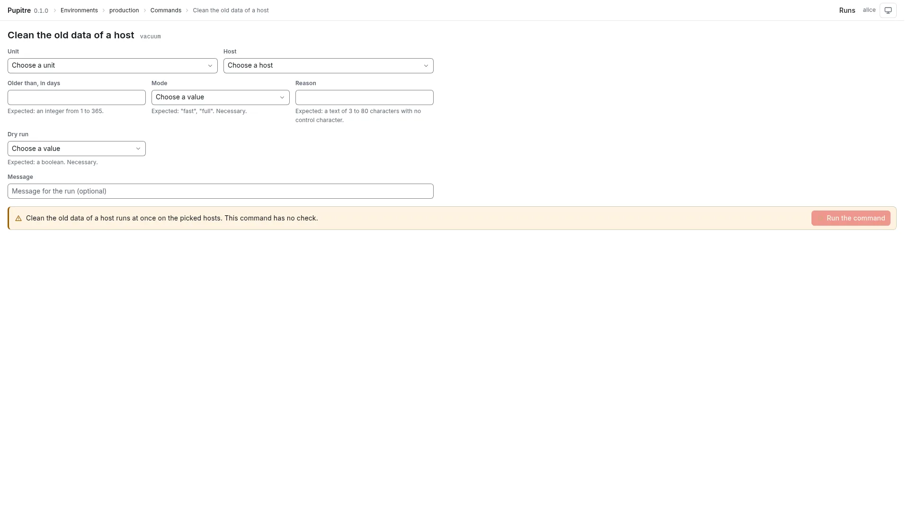 |
| The first step of a check, with the choice of hosts. | A named command, with typed parameters. |
| 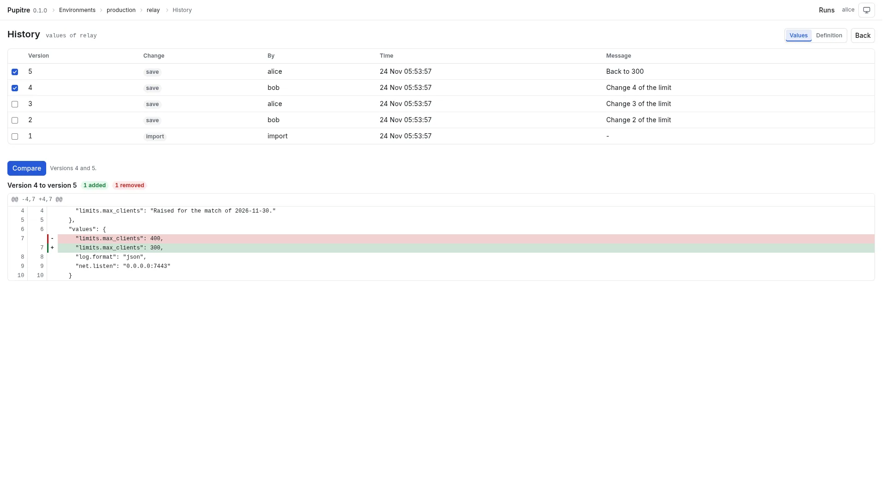 | 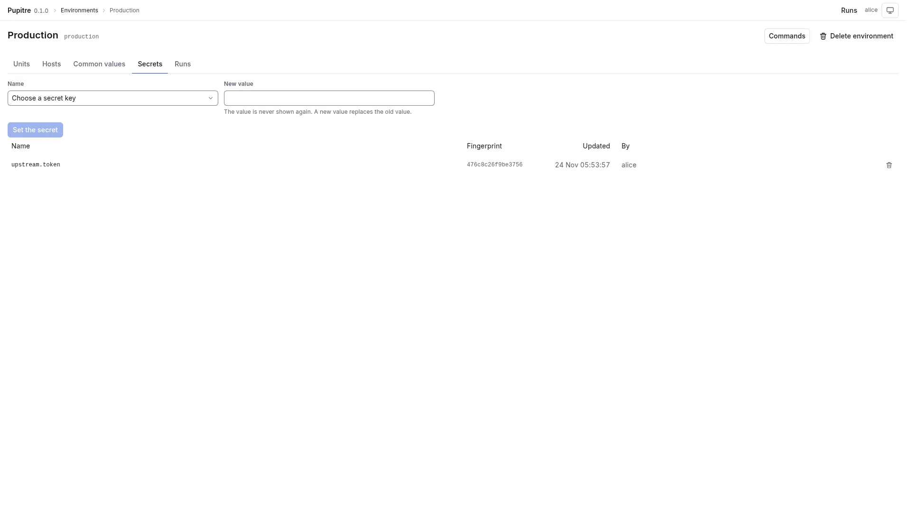 |
| The history of a document, with the difference of two versions. | The secrets of an environment. The page never shows a value. |

The pictures use synthetic data.

## Quick start

Download Pupitre and check the archive. The file `SHA256SUMS` lists the checksum. The commands then print a complete configuration file. The guide [docs/GETTING-STARTED.md](docs/GETTING-STARTED.md) has the ten-minute test. It needs `ansible-playbook` of ansible-core 2.19 or later and one test host that accepts an SSH key.

```sh
git clone --depth 1 https://github.com/ProcurAuth/pupitre.git
curl -fsSLO https://github.com/ProcurAuth/pupitre/releases/download/v0.1.0/pupitre_0.1.0_linux_amd64.tar.gz
curl -fsSLO https://github.com/ProcurAuth/pupitre/releases/download/v0.1.0/SHA256SUMS
sha256sum --check --ignore-missing SHA256SUMS
tar -xzf pupitre_0.1.0_linux_amd64.tar.gz
pupitre_0.1.0_linux_amd64/pupitre print-reference --format hcl --profile local
```

The last command prints a complete configuration file of the profile `local`. The folder `pupitre/examples/local` has the example schemas and playbooks. [docs/GETTING-STARTED.md](docs/GETTING-STARTED.md) explains each step: the keys, `check-config`, `migrate`, `import`, `serve` and the first runs. To build the binary from the source, read [docs/DEVELOPMENT.md](docs/DEVELOPMENT.md).

## The ProcurAuth family

Pupitre is a program of the [ProcurAuth](https://github.com/ProcurAuth) organisation. The organisation holds the open specification and the programs that follow it. The [implementations page](https://procurauth.github.io/procurauth/implementations.html) lists them, with the results of the conformance runs.

<p align="center">
  
</p>

| Part | Role | Repository | Site |
| --- | --- | --- | --- |
| **procurauth** | The specification and the reference tools | [ProcurAuth/procurauth](https://github.com/ProcurAuth/procurauth) | [procurauth.github.io/procurauth](https://procurauth.github.io/procurauth/) |
| **portal** | Backend, edge and PDP | [ProcurAuth/portal](https://github.com/ProcurAuth/portal) | [procurauth.github.io/portal](https://procurauth.github.io/portal/) |
| **Stowr** | PEP: a browser for S3, Google Cloud Storage and folders | [ProcurAuth/stowr](https://github.com/ProcurAuth/stowr) | [procurauth.github.io/stowr](https://procurauth.github.io/stowr/) |
| **Hune** | PEP: dashboards over ClickHouse, PostgreSQL and MongoDB | [ProcurAuth/hune](https://github.com/ProcurAuth/hune) | [procurauth.github.io/hune](https://procurauth.github.io/hune/) |
| **Pupitre** | PEP: configuration of services and Ansible runs | [ProcurAuth/pupitre](https://github.com/ProcurAuth/pupitre) | [procurauth.github.io/pupitre](https://procurauth.github.io/pupitre/) |
| **ClickHouse Dash** | PEP and MCP server: a query console for ClickHouse | Outside this organisation | [Implementations page](https://procurauth.github.io/procurauth/implementations.html#programs) |

To add a program to this list, open an issue in the [specification repository](https://github.com/ProcurAuth/procurauth/issues).

## Documentation

| Page | Content |
| --- | --- |
| [Getting started](docs/GETTING-STARTED.md) | The ten-minute test, step by step. |
| [Configuration](docs/CONFIGURATION.md) and [reference](docs/configuration-reference.md) | The rules, the blocks, the keys. The reference comes from the code. |
| [Architecture](docs/ARCHITECTURE.md) | The documents, the layers, the stores, the runner and the guard of an apply. |
| [Access](docs/ACCESS.md) | The modes `open` and `authzen`, the resource tree, the actions and the errors. |
| [Security model](docs/SECURITY-MODEL.md) | What Pupitre protects, and how. |
| [Operations](docs/OPERATIONS.md) | Run, network, health, logs, backup, upgrade and troubleshooting. |
| [Specification](docs/SPECIFICATION.md) | The eight parts: overview, model, access, runner, API, configuration, security and delivery. |
| [Development](docs/DEVELOPMENT.md) | The checks, the tests, the dependencies and the release. |
| [Changelog](CHANGELOG.md) | The changes of each version. |

The same pages are on the [website](https://procurauth.github.io/pupitre/). The Markdown files are the source.

## Build and test

The scripts use Docker. Nothing is installed on the host. The toolchain is fixed in `rust-toolchain.toml`.

```sh
scripts/cargo.sh fmt --all -- --check
scripts/cargo.sh clippy --workspace --all-targets --all-features --locked -- -D warnings
scripts/cargo.sh test --workspace --locked
scripts/static.sh
python3 -I scripts/check-docs.py
```

The script `scripts/check.sh` runs the checks of the CI. The workflows in `.github/workflows` run the same scripts on GitHub. The script `tools/release-local.sh` makes a release from a local machine.

## Security

Do not open a public issue for a vulnerability. Use the [private report](https://github.com/ProcurAuth/pupitre/security/advisories/new). [SECURITY.md](SECURITY.md) tells the supported versions and the response times. The [security model](docs/SECURITY-MODEL.md) tells what Pupitre protects.

## Contribute

Read [`CONTRIBUTING.md`](CONTRIBUTING.md). Open an issue to ask a question or to report a defect. This project follows the [code of conduct](CODE_OF_CONDUCT.md).

## Licence

Pupitre is under the licence `MIT OR Apache-2.0`. You can use it under the terms of either licence. The files [`LICENSE-MIT`](LICENSE-MIT) and [`LICENSE-APACHE`](LICENSE-APACHE) hold the two texts. The third-party code keeps its own licence: see [THIRD-PARTY-NOTICES.md](THIRD-PARTY-NOTICES.md).
