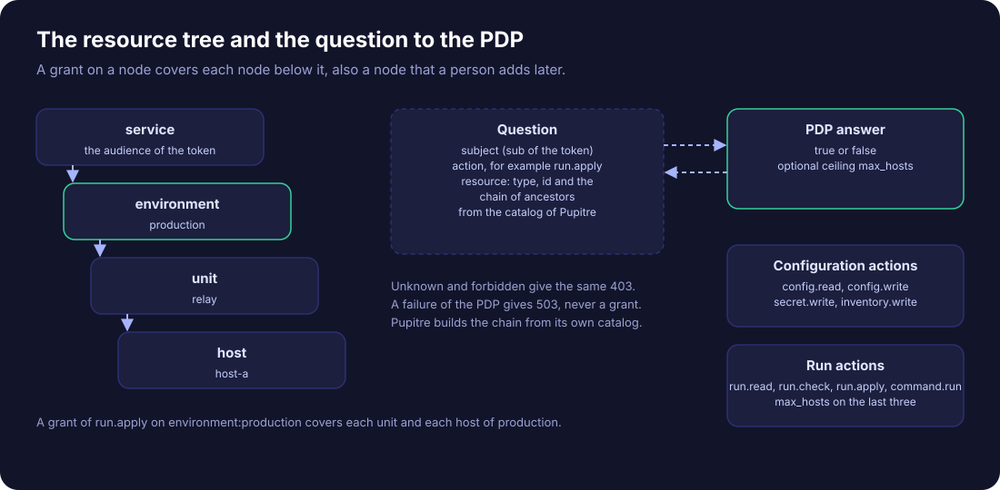

# Access and ProcurAuth

Pupitre has no login of its own. The key `access.mode` has two values: `open` and `authzen`. The block `access` is mandatory and has no default, so no instance gets the mode `open` by error. Part 3 of the [specification](03-access.md) has the rules.

## The two modes

| | `open` | `authzen` |
| --- | --- | --- |
| Token | None. The subject is `-`. | An identity token on each request |
| Who guards the page | The reverse proxy | The edge and the PDP |
| Questions | None | One or more for each operation |
| `run.apply` and `command.run` | Refused with `403 apply_disabled`, unless `runner.allow_apply_in_open_mode = true` | Decided by the PDP |
| The two ProcurAuth routes | `404 not_found` | Served |

In the mode `open`, a reverse proxy MUST authenticate each person before the main listener. The proxy MUST send the public name of the service in `Host`, and `server.allowed_hosts` MUST list that name (7.4 of the specification). Pupitre then trusts each request. The mode writes the warning `access.mode_open` at each start.

## The mode authzen

In the mode `authzen`, Pupitre is a PEP of [ProcurAuth](https://github.com/ProcurAuth/procurauth). An edge signs an identity token and sends it in a header. Pupitre checks the token, then asks a decision point (PDP) before each operation. A PDP that does not answer gives `503`, never a grant.

This `access` block makes Pupitre check the tokens of an edge and ask a PDP:

```hcl
access {
  mode = "authzen"

  identity {
    header           = "X-Identity-Token"
    issuer           = "https://edge.example.invalid"
    audience         = "pupitre"
    public_keys_file = "/run/secrets/edge/jwks.json"
    max_age          = "5m"
    clock_skew       = "1m"
  }

  pdp {
    url             = "https://pdp.example.invalid:4182"
    token_file      = "/run/secrets/pdp/token"
    ca_file         = "/run/secrets/pdp/ca.pem"
    plain_http      = false
    timeout         = "500ms"
    cache_ttl       = "30s"
    max_connections = 4
  }
}
```

The key `access.identity.audience` is the service id. It is also the member `server` of the action document. The credential of Pupitre at the PDP goes in a header `Authorization: Bearer`. It is a secret, so the file accepts it only with `_env` and `_file`.

The public keys of the edge are a JWK Set or PEM text, with 1 to 16 keys. A JWK Set with more than one key needs a different `kid` in each key. A PEM key gets its RFC 7638 thumbprint as `kid`. A token with the `sub` value `-`, `external` or `import` gives `401 unauthenticated`, because the history uses these names.

Keep `access.options_max_questions` at 8 or more with `runner.enabled = true`, and at 4 or more with `runner.enabled = false`. One item can need that many questions. A lower value stops the start. The default is far above the minimum.

## The resource tree

The tree has the service, the environments, the units and the hosts. A grant on a node covers each node below it, also a node that a person adds later.



A host node is always below a unit. The same host in two units is two nodes. A grant of `run.apply` on `environment:production` covers each unit and each host of `production`, now and later. Pupitre builds the chain of ancestors of a node from its own catalog, never from a value of the request.

## The actions

| Action | What it permits |
| --- | --- |
| `config.read` | Read the documents, the effective values, the provenance, the history and the metadata of the secrets. Never a secret value. |
| `config.write` | Write the values of a layer: `common` on an environment, `unit_values` on a unit, `host_values` on a host. |
| `secret.write` | Set and delete a secret of an environment or a unit. No action reads a secret value. |
| `inventory.write` | Create, change and delete environments, hosts and units. |
| `run.read` | Read the runs, their events and their output. |
| `run.check` | Start a check run or a status run of a unit. Cancel such a run. |
| `run.apply` | Start an apply run of a unit. Cancel such a run. |
| `command.run` | Start a command of the catalog, in check or apply. Cancel such a run. |

The last four actions exist only with `runner.enabled = true`. With `runner.enabled = false`, Pupitre publishes the first four actions, and the run routes give `404 not_found`.

## The ceiling max_hosts

The actions `run.check`, `run.apply` and `command.run` have the ceiling `max_hosts`. It is the most hosts of one run. The bound that applies is the lower of two values: `runner.max_hosts`, and the ceiling that the PDP gives with its answer. A run with more hosts gets `403 ceiling_exceeded`. Pupitre never runs a part of the hosts.

## The ProcurAuth routes

| Route | Content |
| --- | --- |
| `GET /.well-known/procurauth/actions` | The action document. It needs no token. Pupitre builds it one time at start. |
| `GET /.well-known/procurauth/resources` | The options route. It lists the children of a node, page by page, for the nodes that the subject can see. |

Both routes give `404 not_found` in the mode `open`. They are below `server.base_path`.

## Errors

| Status | Code | Cause |
| --- | --- | --- |
| 401 | `unauthenticated` | No token, a token that is not valid, or two copies of the header |
| 403 | `forbidden` | The PDP answered `false`. The body has the member `action`. |
| 403 | `ceiling_exceeded` | More hosts than the effective `max_hosts` |
| 403 | `apply_disabled` | An apply or a command in the mode `open` with no `runner.allow_apply_in_open_mode = true` |
| 403 | `approval_cannot_wait` | The grant needs an approval, and no route of Pupitre can wait |
| 404 | `not_found` | An unknown item after the check, or a feature that is off |
| 503 | `pdp_unavailable` | The PDP gave no valid answer in time |

An unknown node and a forbidden node give the same answer. A subject without the right learns nothing about a unit that exists. The list routes show only the items that the subject can see.

## Revoked grants

Each write and each run asks the PDP with no kept answer. A revoked grant thus stops them at once. A read route can use a kept answer for `access.pdp.cache_ttl` at most. Pupitre keeps only a `true` answer to the question `access`, and never a `false` answer. Each instance has its own cache.

## Approvals

No route of Pupitre can wait for an approval. A key with a grant that has `confirm` cannot use that action through the API. A person never gets this refusal. [Security model](SECURITY-MODEL.md) lists this limit.
