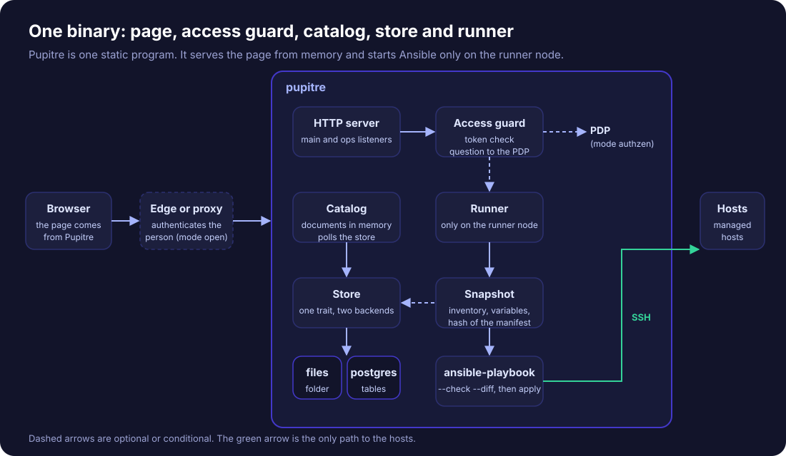
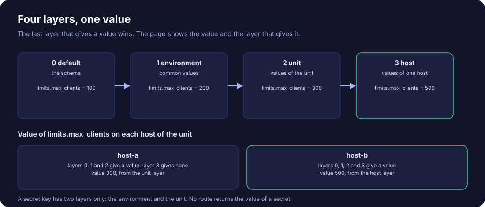
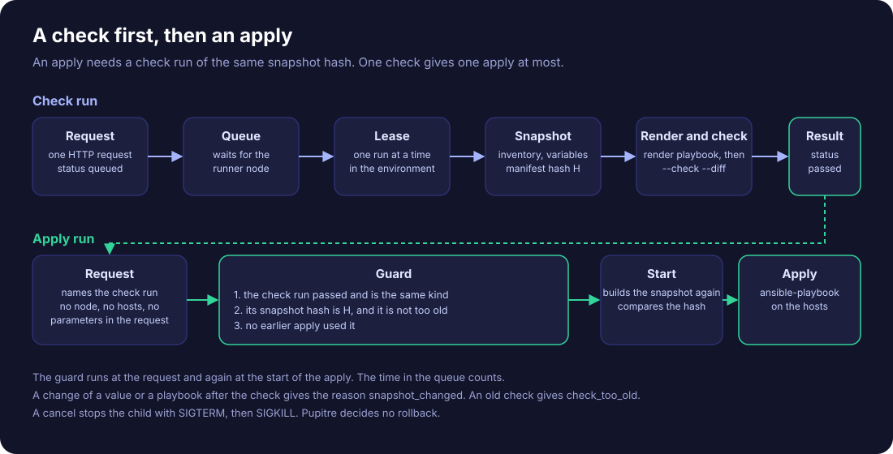

# Architecture

Pupitre is one static binary with the page inside. It keeps the values of services in layers, and it starts Ansible runs on a snapshot of these values. This page tells how the parts work together. The [specification](SPECIFICATION.md) has the rules.

## The single binary

The binary `pupitre` has the HTTP server, the access guard, the catalog, the store, the runner and the page. The workspace has five crates. The crate `pupitre-core` does no I/O. It holds the formats and the rules of the values.

| Part | Role |
| --- | --- |
| HTTP server | The main listener serves the page, the API and the two ProcurAuth routes. The ops listener serves `/livez`, `/readyz` and `/metrics`. |
| Access guard | In the mode `authzen`, it checks the identity token and asks the PDP. In the mode `open`, it asks nothing. |
| Catalog | It keeps the current documents in memory, with their etags. It reads the store again at a fixed period. |
| Store | One trait with two backends: a folder (`files`) and PostgreSQL (`postgres`). Both pass the same contract suite. |
| Runner | It exists on the runner node only. It builds snapshots, starts `ansible-playbook` and reads its events. |
| Page | Plain HTML, CSS and JavaScript in the binary. No framework, no build step and no request to another origin. |

Pupitre has no scheduler. No run starts by itself. Each run starts from one HTTP request of a subject. Pupitre makes no request to the internet. It connects only to the hosts of the configuration: the PDP, the PostgreSQL server, the OTLP collector and the managed hosts.

## The documents and the layers

The store keeps six kinds of document, each one a JSON object in one canonical form. The form has sorted members, two spaces of indent and no float. It is also valid YAML. A file of the backend `files` is thus easy to read in a review of Git.

| Kind | Content |
| --- | --- |
| `environment` | The label of an environment |
| `common` | The values of the layer `environment` |
| `host` | The address, the port and the labels of a host |
| `unit` | The label, the schema, the playbooks and the hosts of a unit |
| `unit_values` | The values of the layer `unit` |
| `host_values` | The values of the layer `host` for one unit on one host |

The effective value of a key on a host comes from four layers. The last layer that gives a value wins. The page shows the value and the layer that gives it.

A secret key has two layers: the environment and the unit. The unit wins. A secret has no default and no host layer. No route returns the value of a secret. The page shows a fingerprint: the start of an HMAC with a key of the server.

The schema of a unit is a file that the configuration names. It lists the keys, their kinds (`text`, `integer`, `duration`, `enum` and others) and their ranges. So a person who edits values cannot add a key, and Pupitre never changes a value to make it fit.

## The two stores

| | `files` | `postgres` |
| --- | --- | --- |
| Where | Three folders: the documents, the secrets and the runs | Nine tables in one database |
| Instances | One. A lock on each folder stops a second process. | One or more |
| Secrets | Files with the mode 0600, in clear text | Encrypted with ChaCha20-Poly1305. The key is not in the database. |
| History | A folder `.history` with each version | A table of versions |
| Outside changes | The documents folder can be a Git checkout. A rescan reads a `git pull`. | None |

Each write checks a precondition. A save needs the etag of the version that the person read. Two writers with one base etag cannot both succeed. The second gets `409 conflict`, and no data is lost. Each key keeps a list of versions with no gap. The history is the audit.

The commands `export` and `copy-store` move documents and versions between stores. `export` writes a folder for a review in Git. It never writes a secret.

## The runner

Each instance can accept a run request. It writes the request in the store with the status `queued`. Only one instance, the runner node, builds snapshots and starts `ansible-playbook`. A restart of the runner node keeps its role.

1. A person starts a check run for a unit and a list of hosts. The request is `queued`.
2. The runner node takes the lease of the environment. One run at a time runs in an environment.
3. The runner builds the snapshot: a folder with the inventory, the variables of each host, the limit file, the variable files and a callback plugin. It computes the hash of the manifest.
4. The render phase runs the render playbook on the runner node. It checks the configuration files and connects to no host.
5. The main phase runs the deploy playbook with `--check --diff`. The callback plugin writes events. The runner scrubs the output and the events before it stores them.
6. The check run gets the status `passed` or `failed`.

An apply run names a check run. The guard of the apply holds when four rules hold. The check run has the status `passed` and the same snapshot hash. It is not older than `runner.check_max_age`. No earlier apply used it. The guard runs at the request and again at the start of the apply.

One check gives one apply at most.

The secrets reach the playbooks as files in a private folder on `tmpfs`. The inventory names each file in the variable `pupitre_secret_files`. No secret is in a variable file or on a command line. The runner removes the folder at the end of the run.

## Commands

A command is a named action of the configuration file with typed parameters. A person launches it by hand on chosen hosts. The parameters go in a variable file, never on a command line. A command with `check = true` follows the check and apply flow. A command with `check = false` runs after the person confirms it.

## Status, cancel and restart

A status run starts the status playbook of the unit. It never starts by itself. A cancel sends `SIGTERM` to the process group of the run, waits `runner.cancel_grace`, then sends `SIGKILL`. Pupitre decides no rollback. The playbook decides what a half run leaves on the hosts.

After a restart of Pupitre, the runner node adopts a child that still lives. It compares the start time of the process and the boot id. Else the run becomes `lost`. Adoption needs a service manager that does not kill the children. [Operations](OPERATIONS.md) tells how to set this.

## The limits

Each list, queue, cache and wait has a bound. Most bounds are keys of the configuration, with a default. At a bound, Pupitre refuses with a documented code. It never cuts or rounds a value. The design supports 64 environments, 1,000 units and 1,000 hosts in one environment, and 100 hosts in one unit. Part 7 of the specification lists each limit.
